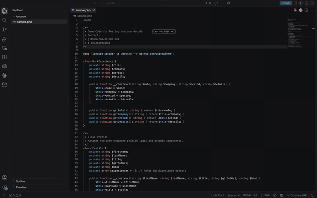
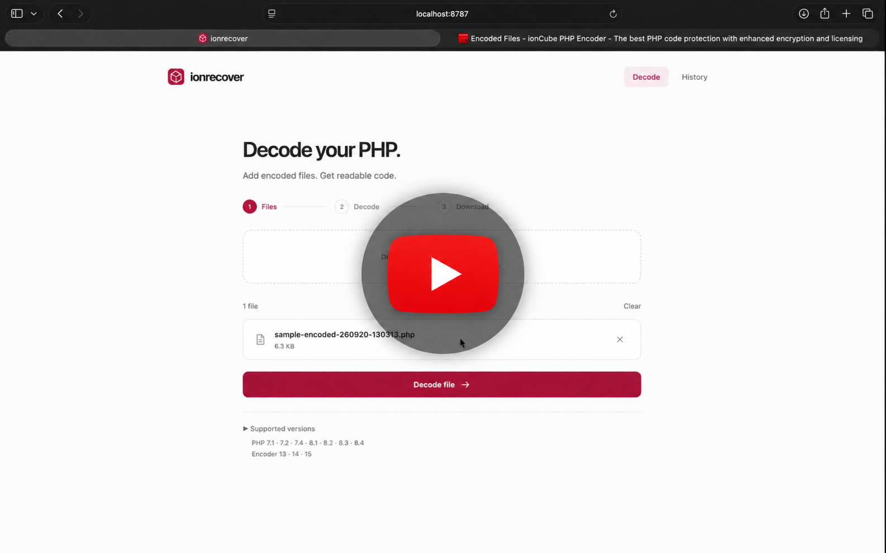

# ionCube Decoder v15
 

🔽🔽🔽🔽🔽🔽🔽🔽🔽🔽🔽🔽🔽🔽🔽🔽🔽🔽🔽🔽🔽🔽🔽🔽🔽🔽🔽🔽🔽🔽🔽🔽🔽🔽
 
### **Check out Online decoders: [ionCube decoder](https://aseweb.ir/ioncube-decoder/) , [SourceGuardian decoder](https://aseweb.ir/sourceguardian-decoder/)**
 
🔼🔼🔼🔼🔼🔼🔼🔼🔼🔼🔼🔼🔼🔼🔼🔼🔼🔼🔼🔼🔼🔼🔼🔼🔼🔼🔼🔼🔼🔼🔼🔼🔼🔼
 
 
 
 
 

*Click the preview to watch the full-quality video.*

*[Watch the demo on YouTube](https://www.youtube.com/watch?v=wCBz6fzBN0Y).*

A commercial ionCube decoder that reconstructs readable PHP through a simple
web interface.

**Test decoding your files with [@ionrecoverbot](https://t.me/ionrecoverbot) on Telegram.**

## Compatibility

| ionCube Encoder | Verified PHP targets | Serialization |
| --- | --- | --- |
| 7.0.8 | 5.3 | 3 |
| 9.0.2 | 5.6 | 5 |
| 9.0.5 | 5.5 | 5 |
| 10.2.0 | 7.1, 7.2 | 5 |
| 10.2.2 | 5.4, 7.1, 7.2 | 5 |
| 11.0.1 | 7.4 | 5 |
| 11.0.2 | 7.1, 7.2 | 5 |
| 12.0.2 | 7.2, 7.4, 8.1 | 5 |
| 13.0.0 | 8.1 | 5 |
| 13.0.1 | 7.2, 7.4, 8.1, 8.2 | 5 |
| 13.0.2 | 7.1, 7.2, 7.4, 8.1, 8.2 | 5 |
| 13.0.3 | 7.4, 8.1, 8.2 | 5 |
| 14.0.0 | 8.1, 8.2 | 5 |
| 14.0.1 | 7.4, 8.1, 8.2, 8.3 | 5 |
| 14.0.2 | 7.1, 7.2, 7.4, 8.1, 8.2, 8.3, 8.4 | 5 |
| 14.0.3 | 8.2 | 5 |
| 15.0.0 | 8.1, 8.2, 8.4 | 6 |
| 15.0.1 | 7.1, 7.2, 7.4, 8.1, 8.2, 8.3, 8.4 | 6 |
| 15.0.2 | 8.2, 8.3, 8.4 | 6 |

These are verified reconstruction profiles, not universal support for every program or protection option. Encoder 9.0.5 / PHP 5.5 includes verified legacy direct calls, runtime function declarations, and uniquely constrained opcode-mask recovery. External key material is still required for modes that encrypt body contents with an unavailable key.

Recognized binary ionCube inputs are identified alongside text-encoded files.
External-key protected files require the correct key material; a missing key
cannot be reconstructed from the protected file alone.

Dynamic-key protected files may require the complete project ZIP, including
key-generating companion files.

## Buy the decoder

Contact **[@amirmalek0](https://t.me/amirmalek0)** on Telegram for pricing. The
complete source code is included, with no license-key or activation requirement.
